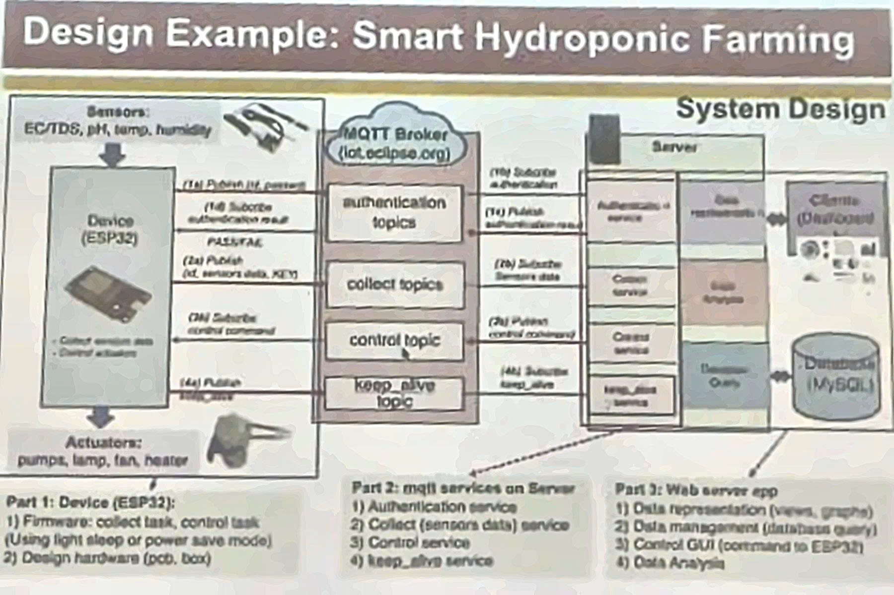
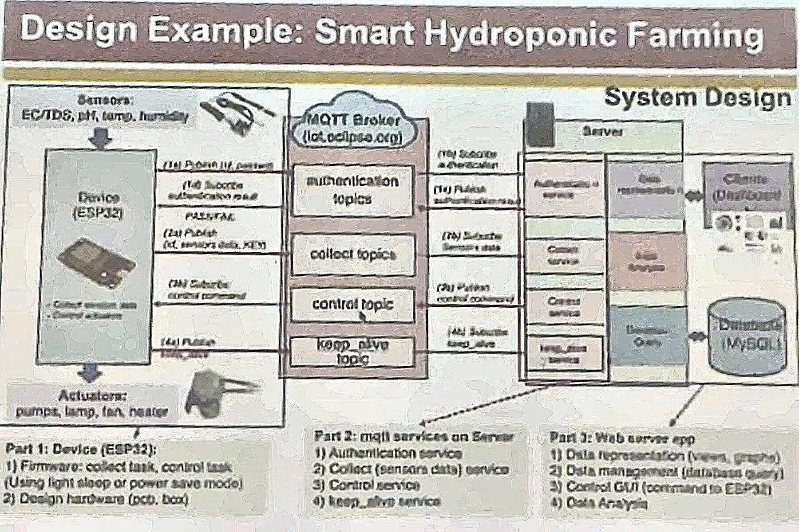

# PCA Image Compression & Image Enhancement System

An end-to-end web-based application applying **Principal Component Analysis (PCA)** for image matrix dimensionality reduction and compression, coupled with computer vision techniques (**OpenCV** & **Pillow**) for adaptive contrast equalization, detail sharpening, and image restoration.

[](https://www.python.org/)
[](https://flask.palletsprojects.com/)
[](https://scikit-learn.org/)
[](https://opencv.org/)
[](LICENSE)

---

## Table of Contents
- [1. Visual Demonstrations](#1-visual-demonstrations)
  - [1.1 PCA Image Compression](#11-pca-image-compression-k--50)
  - [1.2 Image Clarification & Enhancement](#12-image-clarification--enhancement)
- [2. Key Features](#2-key-features)
- [3. Theoretical & Mathematical Foundation](#3-theoretical--mathematical-foundation)
- [4. Tech Stack](#4-tech-stack)
- [5. Installation & Setup](#5-installation--setup)
- [6. Usage Guide](#6-usage-guide)
- [7. Project Structure](#7-project-structure)
- [8. Experimental Results & Metrics](#8-experimental-results--metrics)
- [9. Supported Formats & Dataset](#9-supported-formats--dataset)
- [10. License & Author](#10-license--author)

---

## 1. Visual Demonstrations

### 1.1 PCA Image Compression ($k = 50$)

The system utilizes **Principal Component Analysis (PCA)** to decompose high-dimensional pixel matrices across RGB channels into their dominant orthogonal eigenvectors. By selecting only the top $k = 50$ principal components, the image retains its core perceptual semantics and structural details while discarding redundant high-frequency dimensions.

<table>
  <thead>
    <tr>
      <th align="center" width="50%"><b>Original Image</b></th>
      <th align="center" width="50%"><b>Compressed & Reconstructed Image (k = 50)</b></th>
    </tr>
  </thead>
  <tbody>
    <tr>
      <td align="center">
        
      </td>
      <td align="center">
        
      </td>
    </tr>
    <tr>
      <td align="center"><em>Raw uncompressed input image</em></td>
      <td align="center"><em>PCA reconstructed image using top $k = 50$ principal components</em></td>
    </tr>
  </tbody>
</table>

---

### 1.2 Image Clarification & Enhancement

The system integrates multi-stage computer vision algorithms (combining **CLAHE** — Contrast Limited Adaptive Histogram Equalization in the CIELAB color space and **Unsharp Masking**) to clarify blurred, degraded, or low-contrast images, boosting local contrast without introducing noise or oversaturating highlights.

<table>
  <thead>
    <tr>
      <th align="center" width="50%"><b>Original Image</b></th>
      <th align="center" width="50%"><b>Enhanced Image (Processed)</b></th>
    </tr>
  </thead>
  <tbody>
    <tr>
      <td align="center">
        
      </td>
      <td align="center">
        
      </td>
    </tr>
    <tr>
      <td align="center"><em>Input image before enhancement</em></td>
      <td align="center"><em>Enhanced output with sharpened edges and optimized local contrast</em></td>
    </tr>
  </tbody>
</table>

---

## 2. Key Features

- **PCA Image Compression & Dimensionality Reduction**:
  - Customizable principal components ($k \in [1, 200]$).
  - Dynamic boundary safety: Automatically clamps $k \le \min(H, W)$ to prevent server exceptions on smaller dimensions.
  - Per-channel independent matrix decomposition across 3-channel RGB as well as 1-channel Grayscale images.
  - Safe alpha channel conversion: Automatically converts RGBA/transparent formats to an opaque white background.
- **Image Enhancement & Detail Clarification (OpenCV & Pillow)**:
  - **Combined (CLAHE + Unsharp Mask)** *(Recommended)*: Adaptive contrast equalization in the LAB color space followed by Gaussian unsharp masking for optimal clarity and crispness.
  - **Detail Sharpening (Unsharp Masking)**: Highlights fine edges, textures, and textual contours.
  - **Adaptive Contrast Enhancement (CLAHE)**: Enhances local contrast in shadowed or foggy regions without clipping.
  - **Laplacian Edge Filtering**: Enhances structural contours via a high-pass spatial convolution kernel.
  - 5 customizable intensity levels (Mild $\rightarrow$ Maximum).
- **Interactive Before / After Comparison**:
  - **Split-screen Comparison Slider**: Smooth interactive handle supporting desktop mouse dragging and mobile touch gestures.
  - Flexible view switching between *Comparison Slider* and *Side-by-Side* display modes.
- **Quantitative Quality Metrics**:
  - Computes Mean Squared Error (**MSE**) and Peak Signal-to-Noise Ratio (**PSNR** in dB).
  - Calculates theoretical mathematical matrix reduction ratios achieved by PCA.
  - Measures sharpness objectively using the **Laplacian Variance** ($Var(\nabla^2 I_{gray})$).
- **Multi-user & Robust Architecture**:
  - UUIDv4 session file naming prevents filename collisions and concurrency race conditions.
  - Comprehensive format compatibility: PNG, JPG, JPEG, WEBP, BMP, JFIF.

---

## 3. Theoretical & Mathematical Foundation

### 3.1 PCA Matrix Dimensionality Reduction

For an image channel matrix $\mathbf{A} \in \mathbb{R}^{H \times W}$:
1. The channel matrix is centered by subtracting the column-wise mean $\boldsymbol{\mu} \in \mathbb{R}^{W}$:
   $$\mathbf{X} = \mathbf{A} - \mathbf{1}\boldsymbol{\mu}^T$$
2. The covariance matrix $\mathbf{C} = \frac{1}{H - 1} \mathbf{X}^T \mathbf{X}$ is decomposed into its orthogonal eigenvectors:
   $$\mathbf{C} = \mathbf{V} \mathbf{\Lambda} \mathbf{V}^T$$
3. Taking the top $k$ principal components $\mathbf{V}_k \in \mathbb{R}^{W \times k}$, the data is projected into reduced subspace:
   $$\mathbf{Z} = \mathbf{X} \mathbf{V}_k \in \mathbb{R}^{H \times k}$$
4. Reconstruction back to the original image space is given by:
   $$\mathbf{\hat{A}} = \mathbf{Z} \mathbf{V}_k^T + \mathbf{1}\boldsymbol{\mu}^T$$

#### Theoretical Storage Elements:
- **Original matrix**: $H \times W$ elements
- **Compressed representation**: $k \times H + k \times W + W = k(H + W) + W$ elements
- **Theoretical Storage Ratio**:
  $$\text{Storage Ratio} = \frac{k(H + W) + W}{H \times W} \times 100\%$$

### 3.2 Evaluation Metrics

- **Mean Squared Error (MSE)**:
  $$\text{MSE} = \frac{1}{H \times W \times C} \sum_{c=1}^C \sum_{i=1}^H \sum_{j=1}^W \left( \mathbf{A}(i, j, c) - \mathbf{\hat{A}}(i, j, c) \right)^2$$
- **Peak Signal-to-Noise Ratio (PSNR)**:
  $$\text{PSNR} = 10 \cdot \log_{10} \left( \frac{255^2}{\text{MSE}} \right) \quad (\text{dB})$$
- **Objective Sharpness (Laplacian Variance)**:
  $$\text{Sharpness} = \text{Var}(\nabla^2 I_{gray})$$

---

## 4. Tech Stack

- **Core Language**: Python (>= 3.9)
- **Web Framework**: Flask 3.1.2, Werkzeug 3.1.4
- **Machine Learning & Linear Algebra**: scikit-learn 1.9.0 (`sklearn.decomposition.PCA`), NumPy 2.2.6
- **Computer Vision & Image Processing**: OpenCV (`opencv-python` 4.13.0), Pillow 12.1.1
- **Frontend Architecture**: Modern HTML5, Responsive CSS3, Vanilla JavaScript (ES6+), Font Awesome 6.4.0
- **Data Visualization**: Chart.js 4.4.0 (Interactive Doughnut Chart)

---

## 5. Installation & Setup

### Prerequisites
- Python 3.9 or higher installed on your system ([Download Python](https://www.python.org/downloads/)).
- Git installed on your system.

### Step-by-Step Installation

1. **Clone the repository**:
   ```bash
   git clone https://github.com/Tienndat2306/PCA_Compress_Image.git
   cd PCA_Compress_Image
   ```

2. **Create and activate a virtual environment**:
   - **On Windows**:
     ```bash
     python -m venv venv
     venv\Scripts\activate
     ```
   - **On Linux / macOS**:
     ```bash
     python3 -m venv venv
     source venv/bin/activate
     ```

3. **Install required dependencies**:
   ```bash
   pip install -r requirements.txt
   ```

---

## 6. Usage Guide

1. **Start the Flask server**:
   ```bash
   python app.py
   ```

2. **Open the Web Interface**:
   Navigate to the local address in your web browser:
   ```text
   http://127.0.0.1:5000
   ```

3. **Using the Application**:
   - **Mode 1: PCA Image Compression**:
     1. Select or drag-and-drop an image file into the upload zone.
     2. Adjust the number of principal components $k$ using the slider (e.g., $k = 50$).
     3. Click **Compress Image Now**. Inspect the reconstructed image, MSE, PSNR, theoretical dimension reduction ratio, and disk footprint chart.
   - **Mode 2: Image Enhancement & Clarification**:
     1. Switch to the **Image Enhancement (OpenCV)** tab.
     2. Choose an enhancement algorithm (e.g., *Combined CLAHE & Unsharp Mask*).
     3. Select an intensity level (1 to 5).
     4. Click **Enhance Image Now** to compare sharpness before and after, inspect the interactive slider, and download the enhanced result.

---

## 7. Project Structure

```text
PCA_Compress_Image/
├── app.py                  # Flask application entry point, PCA routines & enhancement filters
├── requirements.txt        # Pinned Python package dependencies
├── .gitignore              # Git ignore rules for virtual environments, caches, and user uploads
├── LICENSE                 # MIT open-source license
├── README.md               # Comprehensive project documentation
├── assets/                 # Sample images and visual demonstration assets
│   ├── blank_space.jpg         # Original sample image for PCA compression demo
│   ├── recon_blank_space.jpg   # Reconstructed image from PCA compression (k = 50)
│   ├── demo.jpg                # Original sample image for enhancement demo
│   └── demo_processed.jpg      # Processed & clarified image from enhancement demo
├── templates/
│   ├── index.html          # Main web interface (HTML5, responsive layout, modal, slider)
│   └── base.html           # Base layout template
├── static/
│   ├── css/                # Custom CSS stylesheet directory
│   └── js/
│       └── chart.js        # Chart rendering scripts
└── uploads/
    └── .gitkeep            # Temporary storage directory for uploaded sessions (tracked via .gitkeep)
```

---

## 8. Experimental Results & Metrics

### Quantitative Evaluation

| Method | Parameters | Key Metrics | Sample Benchmark Result |
| :--- | :--- | :--- | :--- |
| **PCA Compression** | $k = 20$ (Image $500 \times 500$) | MSE / PSNR | MSE: ~15.2, PSNR: ~36.3 dB, Dimension reduction: **92.0%** |
| **PCA Compression** | $k = 50$ (Image $500 \times 500$) | MSE / PSNR | MSE: ~6.8, PSNR: ~39.8 dB, Dimension reduction: **80.0%** |
| **PCA Compression** | $k = 100$ (Image $500 \times 500$) | MSE / PSNR | MSE: ~2.1, PSNR: ~44.9 dB, Dimension reduction: **60.0%** |
| **Enhancement (Unsharp Mask)** | Strength = 2, $\sigma = 1.3$ | Laplacian Variance ($Var$) | Sharpness increased from **~85.4** to **~196.2** (+129.7%) |
| **Enhancement (Combined)** | Strength = 2, ClipLimit = 2.2 | Laplacian Variance ($Var$) | Sharpness increased from **~85.4** to **~238.6** (+179.4%) |

---

## 9. Supported Formats & Dataset

- **Supported Formats**: PNG, JPG, JPEG, WEBP, BMP, JFIF.
- **Recommended Resolutions**: From $100 \times 100$ px up to $4000 \times 4000$ px (Maximum upload size: 16 MB).
- **Dataset Agnostic**: Works dynamically on any user-provided photographic, artistic, or documentary image without pre-training or external weight downloads.

---

## 10. License & Author

### License
This project is open-source software licensed under the **[MIT License](LICENSE)**.

### Author
- **Author**: Tienndat2306 (Tien Dat)
- **Email**: [dattrithuc123@gmail.com](mailto:dattrithuc123@gmail.com)
- **GitHub**: [@Tienndat2306](https://github.com/Tienndat2306)
